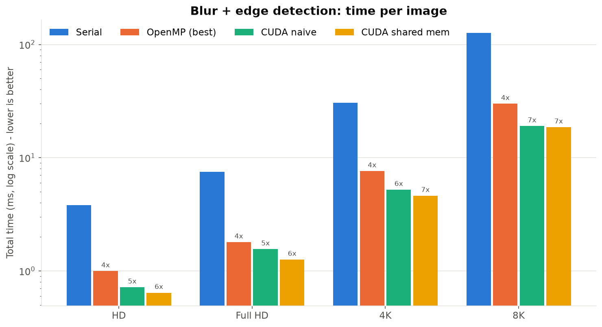
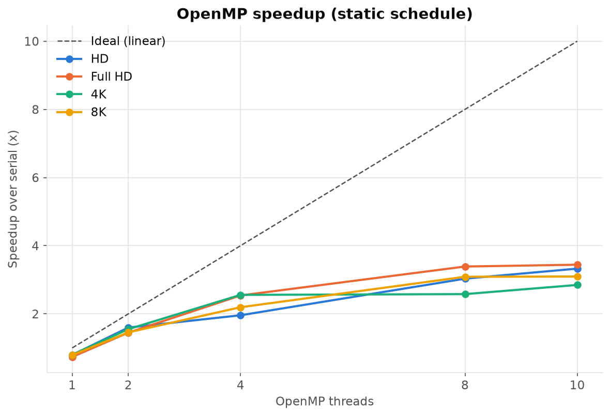
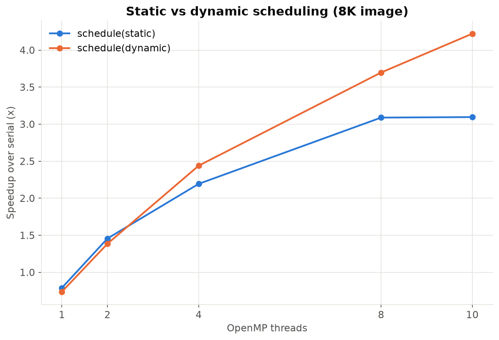
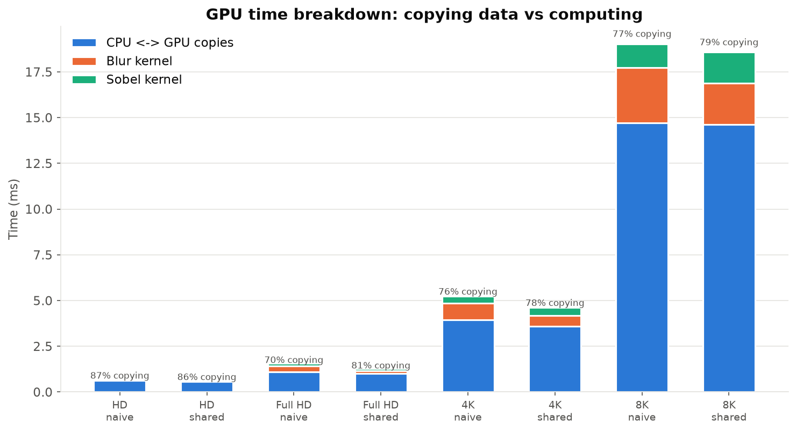

# Parallel Image Edge Detection: Serial vs OpenMP vs CUDA

Edge detection on large images (HD → 8K), implemented three ways and benchmarked for the
**Parallel Computing** course: a serial C baseline, a shared-memory **OpenMP** version, and an
NVIDIA **CUDA** version (naive and shared-memory kernels).

The pipeline: **grayscale image → 5×5 Gaussian blur (removes noise) → 3×3 Sobel filter (finds edges)**.


## Implementations

| Version | File | How the work is split |
|---|---|---|
| Serial | `serial.c` | One CPU core, pixel by pixel; the baseline for every speedup |
| OpenMP | `openmp.c` | Image rows shared among CPU threads with `#pragma omp parallel for schedule(runtime)` |
| CUDA naive | `cuda.cu` | One GPU thread per pixel, 16×16 blocks, neighbours read from global memory |
| CUDA shared memory | `cuda.cu` | Each block copies its tile + halo into on-chip shared memory, then `__syncthreads()` |

All versions produce **bit-identical output**, verified pixel by pixel against the serial version.

## Results

CPU: Apple M5, 10 cores (4 performance + 6 efficiency), clang -O2.
GPU: NVIDIA Tesla T4 (Google Colab), nvcc -O2. Times are the best of 5 runs.

| Image | Serial | OpenMP (10 threads) | Speedup | CUDA kernels only | CUDA incl. copies | GPU speedup (kernels / with copies) |
|---|---|---|---|---|---|---|
| HD (1280×720) | 3.8 ms | 1.0 ms | 3.8× | 0.09 ms | 0.64 ms | 44× / 6× |
| Full HD | 7.5 ms | 1.8 ms | 4.2× | 0.24 ms | 1.26 ms | 32× / 6× |
| 4K | 30.6 ms | 7.6 ms | 4.0× | 1.04 ms | 4.61 ms | 29× / 7× |
| 8K (33.2 MP) | 126.4 ms | 29.9 ms | 4.2× | 3.96 ms | 18.58 ms | 32× / 7× |



### Key findings

- **OpenMP speedup flattens after 4 threads** (~4.2× on 10): only 4 of the M5's cores are fast
  performance cores, the filter is memory-bound, and threading has overhead.
- **`schedule(dynamic)` beats `schedule(static)`** at 8–10 threads (8K: 40.8 → 29.9 ms): with
  equal rows per thread, fast cores wait for the slow efficiency cores (load imbalance).
- **Amdahl's law:** the measured serial fraction (Karp–Flatt) is f ≈ 0.15, so the ceiling is ≈ 6.6×
  no matter how many cores.
- **On the GPU, copying dominates:** ~79% of the 8K time is moving data between CPU and GPU. The
  kernels alone are 32× faster than serial; including copies, 6.8×.
- **Shared memory helped the blur (26% faster) but not Sobel (32% slower):** the 5×5 blur reuses each
  pixel 25 times; the 3×3 Sobel has too little reuse to pay for the tile copy and `__syncthreads()`.

| OpenMP speedup | Static vs dynamic | GPU time breakdown |
|---|---|---|
|  |  |  |

Raw data: [`results/mac_cpu.csv`](results/mac_cpu.csv), [`results/colab_gpu.csv`](results/colab_gpu.csv),
summary table: [`charts/summary.md`](charts/summary.md).

## Running it

### CPU versions (macOS or Linux)

```bash
brew install libomp                  # macOS only: OpenMP runtime for Apple clang
pip install pillow matplotlib

make                                 # builds ./serial and ./openmp
python3 tools.py prepare             # test images in images/  (or: --photo your.jpg)
bash bench.sh cpu                    # -> results/cpu.csv
python3 tools.py compare             # verify outputs match serial
python3 plot.py results/cpu.csv      # -> charts/
```

### CUDA version (Google Colab)

1. Upload `Parallel_Image_Filters_Colab.ipynb` to [Colab](https://colab.research.google.com)
2. *Runtime → Change runtime type → T4 GPU*, then *Runtime → Run all*

The notebook writes all source files, compiles, benchmarks, checks correctness, draws the charts
and downloads `results.zip`. After editing any source file, regenerate it with `python3 make_notebook.py`.

### Live demo

- `bash demo.sh`: step-by-step CPU demo (serial → OpenMP 1–10 threads → static vs dynamic →
  correctness check → opens the result). Press Enter between steps.
- Colab notebook, section 10: times both CUDA kernels on 8K and shows the output.

## Files

```
common.h        PGM image I/O, timer, per-pixel filter math (shared by all versions)
serial.c        serial baseline
openmp.c        OpenMP version
cuda.cu         CUDA version: naive + shared-memory kernels
Makefile        make (CPU) / make cuda (GPU)
bench.sh        benchmarks every version and image size -> results/*.csv
demo.sh         live demo script for the presentation
tools.py        make test images, verify outputs, export PNGs
plot.py         charts + summary table
make_notebook.py                     builds the Colab notebook from the source files
Parallel_Image_Filters_Colab.ipynb   self-contained Colab notebook
docs/           presentation notes and images
```

**Report:** [`docs/Parallel_Image_Edge_Detection_Report.pdf`](docs/Parallel_Image_Edge_Detection_Report.pdf) · **Slides:** [`docs/Parallel_Image_Edge_Detection_Slides.pdf`](docs/Parallel_Image_Edge_Detection_Slides.pdf) · Slide plan and likely viva questions: [`docs/PRESENTATION_NOTES.md`](docs/PRESENTATION_NOTES.md)
